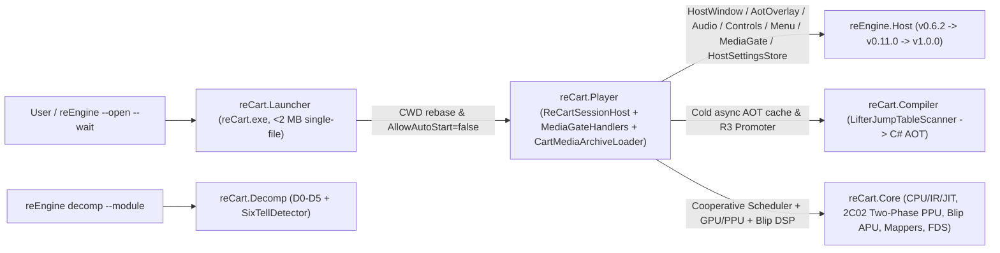

# reCart — Architecture & Engineering (`v0.1.3` Live -> `v0.2.0`–`v1.0.0` Backend Design)

Architecture specification for **`reCart`** (3-way alias `reCart` <-> `reCartOne` <-> `reNes`; workspace directory `Personal/reCartOne`; solution `Dev\reCart.slnx`). Built cleanly on **`Foundation v0.5.5`** and **`reEngine v0.6.2`** (`reEngine.Core`, `reEngine.Host.dll`). Keep `Foundation\`, `reEngine\`, `reStation\`, `_DevBible\`, and `%LOCALAPPDATA%\Programs\` strictly read-only.

---

## 1. Core Thesis: AOT-Primary Static Recompilation Stack

`reCart` is strictly an **ahead-of-time (AOT) static recompilation stack — never a generic compatibility emulator**:

1. **Tier 1 — Native C# Hardware Core (`reCart.Core`):** `CartMachineHost`, `Cpu2A03Core`, `CartMemoryBus`, `Ppu2C02Core`, `Apu2A03Core`, `CartInputPorts`, `ICartMapper`, and `CartQuickSaveSerializer` (`F5`/`F9`).
2. **Tier 2 — Player-PC Local AOT Static Translation (`StaticAotOnly` Default):** `Lifter6502ToCSharp`, `LifterJumpTableScanner` (`DiscoverInlineJumpTableTargets` reading `recipe.JumpTables` across fixed and switchable banks), and `CleanRoomRecompPackager` support strictly 3-member lifted archives (`module.recomp.json`, `lifted/CartLiftedModule.cs`, `lifted/dispatch.meta.json`) **and** 2-member clean-room recipe archives (`module.recomp.json`, `aot-recipe.json` -> `CartAotRecipeSpec`). `ColdAotCacheCompiler` validates clean-room bounds, lifts recipe archives locally against user BYO `.nes`/`.prg`/`.zip`/`.7z` media (`CartPrgHeaderSynthesizer` + `CartMediaArchiveLoader` backed by `Foundation.Retro.MediaContainerExtractor` and bundled `app\tools\{7z.exe,7z.dll,LICENSE-7ZIP.txt}` with ephemeral `finally` cleanup & fail-closed `InvalidDataException`), compiles asynchronously out-of-process (`--disable-build-servers -p:UseSharedCompilation=false -nodeReuse:false`) while `HostSessionRunner` opens the SDL3 window immediately with live progress on `HostAotCompileOverlayView`, puts `.Generated.dll` into `<dataDir>\cache\<moduleId>\<key>\`, and loads via `AssemblyLoadContext.LoadFromStream`. Unlifted PCs fail closed (`UnliftedPcTrapException`, caught interactively by `ReCartSessionHost`).
3. **Tier 3 — Unified `6502 -> Shared IR`, Collectible RyuJIT & Zero-RWX (`v0.2.0` -> `v0.7.0`):** Single `6502 -> Shared IR` lowerer (`reCart.Core\Ir\`, shared across JIT and `reCart.Compiler`) powering Collectible RyuJIT (`win-x64`) and Zero-RWX Threaded-IR (`W^X` hosts), keyed by multi-window 8 KB `(ulong prgBankSignature, ushort pc16, uint ramEpoch)` with `CartRamEpochTable` (`16 B` sub-line masks across `$0000–$07FF` WRAM and up to `64 KB` PRG-RAM/`FDS`-RAM + `SmcDemotionThreshold = 8` hot-SMC demotion). Feeds `--jit-bringup` (`ExitCode = 5` non-VBlank spin watchdog + `bringup.profile.json`), best-effort standalone raw `.nes`/`.fds` JIT boot (`R04 §2.2`, `v0.7.0`), and automated `R3` static AOT promotion (`isPureStaticReady == true`, `v0.7.0`).
4. **Tier 4 — Quarantined `InterpreterOracle` (`--execution-tier interpreterOracle` / `--lockstep-oracle --lockstep-steps <n>`):** Isolated strictly behind `InterpreterOracle.CreateAuthorized` and `ReCartLockstepRunner`; throws `InvalidOperationException` under `StaticAotOnly` or `JitBringup`.

---

## 2. Hardened Subsystem Back-End Pipelines & Upstream Alignment

### 2.1 Cycle-Paced Static AOT Dispatch (`v0.1.2`) & Cooperative Scheduler / Shared IR (`v0.2.0`)
- **`v0.1.2` Cycle-Paced `CartMachineHost` Fix:** `CartMachineHost.StepCpuAndApuCycle` (`Dev\src\reCart.Core\Runtime\CartMachineHost.cs#L270-L348`) now dispatches statically lifted 6502 basic blocks (`TryDispatchStaticBlock`) and edge-triggered interrupts (`_pendingAotNmi` `0xFFFA` / `_pendingAotIrq` `0xFFFE`) cycle-by-cycle using `_cpuCycleCredit` inside the PPU dot loop rather than once at frame end.
- **`v0.2.0` Full Cooperative Scheduler & Shared IR:** Expands `CartMachineHost.StepFrame` to unify Static AOT, Collectible RyuJIT, and Zero-RWX Threaded-IR inside the PPU dot loop:
  - Emits hardware catch-up checkpoints on every MMIO access (`$2000–$2007`, `$4000–$4017`, mapper `$4020–$FFFF`), block exit, and backward branch.
  - Emits real 6502 RMW dummy writes (critical for consecutive `MMC1` writes), indexed-read page-cross dummy reads, incremental `$4014`+`$2003` OAM DMA stepping (`513`/`514` cycles w/ concurrent PPU/APU ticks), non-oracle `DMC` stall debiting, `$4015` bit-5 open-bus mixing, `CLI`/`SEI`/`PLP` 1-instruction IRQ delay, and region-accurate `ExecuteResetVector()` ratios.
  - Requires blocks to terminate cleanly before `8 KB` PRG bank boundaries (`$7FFF/$9FFF/$BFFF/$DFFF`) via `ICartBlockAddressMapper.GetPrgBankSignature(ushort pc)`.
- **Host Resilience (`v0.2.0`):** Standard 18 toggles (`isJitEnabled`, `shouldPreloadMediaToRam`, `isFastBootEnabled`, `booting.sentinel` -> `isSafeModeActive`), FourCC `RCARTQS2` QuickSave envelopes (`BUS0`, `CPU0`, `PPU0`, `APU0`, `MAP0`, `EXPA`, `FDS0`, `ZAP0` w/ region validation and `ramEpoch` clear on load), and `RPT-recart-0.1.0-20261120-0115` (`ValidateD5Core` v2 keys).

### 2.2 Regional Clocks & Dual-Layer Blip-Buffer Audio (`v0.3.0`)
- **Timing (`CartRegionTimingProfile`):** `NTSC` (`3:1`, `60.0988 Hz`, `262` scanlines, odd-frame dot `339->0` skip), `PAL` (`16:5`, `50.0070 Hz`, `312` scanlines, PAL APU tables, no skip), `Dendy` (`3:1`, `50.0070 Hz`, `312` scanlines, VBlank `291`). Live `F1` / `--region` switching re-binds `TimingProfile`, `TargetFps`, pixel aspect, and APU clock together.
- **CPU-Cycle Blip-Buffer + Two-Layer `R06` Attribution:** Replaces point-sampling with band-limited Blip-buffer delta integration (`$4017` 3/4-cycle reset delay preserved), deterministic `--dump-audio` WAV hashes, and presentation-isolated VRR/DRC rate clamping (`±0.5%`). Hardware layer drives per-channel gains (`Pulse1`, `Pulse2`, `Triangle`, `Noise`, `DMC`, `Expansion`) via tangent-weighted dual Blip-buffers; opt-in `ICartAudioBusClassifier` & `ICartSoundTestProvider` annotate true `BGM`/`SFX`/`Voice` tracks for `.recomp` titles. **`reEngine.Host v0.6.0` owns host biquad LP/HP filters (`R06 §4`)** — zero duplicate biquad DSP inside `reCart.Core`.

### 2.3 Two-Phase Scanline `ParallelCpu` PPU & Native GPU Compositor (`v0.4.0`)
- **Phase 1 (Serial Dot Capture — `Ppu2C02Core` + `Ppu2C02DotPipeline`):** Fixes `dot == 257` slot-0 nametable fetch and adds `MMC3` M2/dot low-time filtering on `OnPpuA12Edge`. Computes cycle-exact `$2002` Sprite-0 hit, hardware 8-sprite overflow, Loopy scrolling, and irq edges while recording immutable `PpuScanlineStateSnapshot[240]`, mid-scanline register-write dot events (`$2000/$2001/$2005/$2006`/palette/CHR), `PrimarySprites[0..7]`, `OverflowSprites[8..63]`, and per-pixel `BG_Opaque`/`Sprite_Behind` priority masks.
- **Phase 2a (`Software` & `ParallelCpu` `1x` Bit-Exactness):** Both render through pure `PpuScanlineRasterizer.RasterizeBand(...)` (`Software` single-pass `[0..240)` vs `ParallelCpu` `Parallel.For` `16px` scanline bands), mathematically guaranteeing `100%` SHA-256 bit-exactness across mid-scanline splits.
- **Phase 2b (Native `GL`/`VK`/`DX12` Compositor — `reCart.Core\Gpu\`):** Consumes `IHostGraphicsContext` (`reEngine v0.6.0` scaled/GPU composite hook + multi-backend `TryReadSurfaceRect`/`FlushAndSyncForSnapshot`) for `>8` sprite rendering (`$2002.5` hardware-exact), 24-bit RGBA sprite/tile overrides (`isTrueColor24BitEnabled`, `isDitheringEnabled`), `SubTick` scrolling (excluding HUD split-scroll lines), `Hor+` `16:9`/`21:9` (`ICartGameFramePatch`), CRT/colorblind shaders, `.pal` presets, `hudAnchorMode`, `F12` capture, and aspect-locked `NativePar` presentation (**never stretching `4:3`**; optical light-gun always raycasts the pre-shader canonical `256x240` luminance buffer).

### 2.4 Upstream `reEngine` Prerequisite Lockstep (`v0.2.0` -> `v1.0.0`)
| `reCart` Minor | Focus | Required `reEngine` Track | Dual-Installer / Settings Alignment |
| :--- | :--- | :--- | :--- |
| **`v0.1.x`** | Live AOT Core Baseline (`v0.1.3` async AOT overlay, `JumpTables`, `.7z`, `MediaGateHandlers`, `HostSettingsStore`) | `v0.5.0`–`v0.6.2` | `7`-file `Auto`, `SettingsDataDirectory`, `HostProtocolVersion = "0.6.2"` |
| **`v0.2.0`** | Cooperative Scheduler, `Shared IR`, RyuJIT / Zero-RWX, `RCARTQS2` | `v0.5.0+` (`v0.6.0` opt-in) | Domain `booting.sentinel` / Standard 18 keys; binds `v0.6.0` UI toggles |
| **`v0.3.0`** | Blip-Buffer DSP, `PAL`/`Dendy`, `R06` Audio Rail, VRR | **`v0.6.0`** | Host `settings.audio.json`, host biquad LP/HP, Sound Test `ExtraRows` |
| **`v0.4.0`** | Two-Phase `ParallelCpu` PPU + GPU Compositor + `R05` Enhancements | **`v0.6.0`** | Multi-backend `TryReadSurfaceRect`, `settings.video.json`, `F12` capture; `7`-file `Auto` |
| **`v0.5.0`** | Commercial Mappers, Vaults/Undo, Peripherals, 10-Rail UI | **`v0.7.0 + v0.8.0`** | **8-file Dual-Installer** (`Foundation` + `v0.8.0`), 10-Rail SDL3 Menu |
| **`v0.6.0`** | Clean-Room FDS HLE + 6 Expansion Chips + `.re*`/Recipes/Manual | **`v0.8.0–v0.10.0`** | Unified Multi-Volume, `assets.catalog.json`, Hot-Reload, Dumper, Recipes |
| **`v0.7.0`** | Raw-Media `R04`, `R3` Promoter, Research Rail, Runtime API, Cert Matrix | **`v0.11.0`** | Research Rail, `HostRuntimeApiServer`, Clean-Capture, Steam/Playtime |
| **`v1.0.0`** | Going Gold (`win-x64`, `2+` Lockstep, Locked `1.x` ABI) | **`v1.0.0`** | `isHumanPlaytestSignedOff`, `win-x64` GA (`v1.1–v5.0` follow on `reEngine`) |

---

## 3. Modular 8-Project Layout (`Dev\reCart.slnx`) & Code Sizing (`<= 250/400/600` SLOC)

Keep **`Dev\reCart.slnx` strictly at 8 assemblies** (avoiding extra cold-AOT compile references), scaling via cohesive folders and file splits (`<= 400` soft ceiling):

| Project (`Dev\`) | Output Type | Live (`v0.1.0`) + Scheduled (`v0.2.0–v0.7.0`) Structure |
| :--- | :--- | :--- |
| `src\reCart.Contracts` | Class Library (`net8.0`) | Live `Cart*` ABI + additive `CartExecutionContracts` (`v0.2.0`), `CartAudioContracts` (`v0.3.0`), `PpuScanlineStateSnapshot` / `ISubTickFrameHook` / `ICartGameFramePatch` (`v0.4.0`), `ICartAssetCatalogProvider` / `ICartFdsVolumeProvider` (`v0.6.0`), `ICartResearchInspector` (`v0.7.0`) |
| `src\reCart.Core` | Class Library (`net8.0`) | Live `Cpu\`, `Mappers\`, `Rom\`, `Ppu\` *(split `Ppu2C02Renderer.cs` `406` -> 4 files `< 250` SLOC in `v0.4.0`)*, `Apu\`, `Input\`, `Runtime\` (`CartMachineHost` cycle-paced `StepCpuAndApuCycle`/`_pendingAotNmi`/`_pendingAotIrq`), `Oracle\`; planned folders `Ir\`, `Jit\`, `Bringup\` (`v0.2.0`), `Apu\Expansion\` (`v0.3.0`/`v0.6.0`), `Gpu\` (`v0.4.0`), `Saves\` (`v0.5.0`), `Fds\` (`v0.6.0`), `Research\` (`v0.7.0`) |
| `src\reCart.Compiler` | Class Library (`net8.0`) | `Lifter6502ToCSharp`, `LifterJumpTableScanner` (`recipe.JumpTables`), `UnliftedPcTrapException`, `CleanRoomRecompPackager`, `ColdAotCacheCompiler`, `SyntheticCleanRoomCartBuilder`; converges on `reCart.Core\Ir\` (`v0.2.0`) + automated `R3` Promoter (`v0.7.0`) |
| `src\reCart.Decomp` | Class Library (`net8.0`) | `CartDecompPlatformProvider` (`platformId: "nes"`), `SixTellDetector`, `D4BuildReportValidator` (v1 + v2 `d5_byte_match.json` keys), `CartCleanRoomValidator`, `CartMediaIntakeInspector` |
| `src\reCart.Player` | WinExe (`net8.0-windows`) | `Program`, `PlayerCliOptions`, `PlayerF1DrawerBuilder`, `CartMediaArchiveLoader` (`Foundation.Retro.MediaContainerExtractor` + bundled `tools\7z.*` + external ROM staging), `ReCartSessionHost` (async `HostAotCompileOverlayView` + `HostSettingsStore` `SettingsDataDirectory` + `MediaGateHandlers` `.recomp` drop / `Select .recomp Module...` / standalone raw-ROM clean-room guidance + interactive `UnliftedPcTrapException` trap catch / `MediaAndInput` `<DataDir>\rom\` discovery / `VerifyAndPump`), `ReCartLockstepRunner`, Debug-only `PlayerAutomationBridge` |
| `src\reCart.Launcher` | Single-File WinExe | `< 2 MB` `reCart.exe`, CWD path normalization, `--autostart*` stripping (`AllowAutoStart = false`) |
| `src\reCart.Installer` | WinExe (`net8.0-windows`) | `Program`, `InstallerCliAndAutomation`, `ReCartSuitePlacementHelper` (`app\tools\{7z.exe,7z.dll,LICENSE-7ZIP.txt}`, `7`-file `Auto` through `v0.4.0` -> `8`-file `Online`+`Offline` Dual-Installer in `v0.5.0`) |
| `tests\reCart.Tests` | xUnit (`net8.0-windows`) | `10` modular test classes (`94/94` isolated `v0.1.3` test cases incl. `PlayerV013PrelaunchTests`) + per-minor backend parity suites (`0` warnings) |

---

## 4. Clean-Room Storage, Security & Testing Boundaries

- **Zero-PII Deterministic Builds:** `Dev\Directory.Build.props` enforces `LangVersion=latest`, `Nullable=enable`, `<TreatWarningsAsErrors>true</TreatWarningsAsErrors>`, `<Deterministic>true</Deterministic>`, `<Product>reCart</Product>`, and Release `<PathMap>`.
- **Zero Retail Assets in Git or `.recomp`:** `.gitignore` excludes `data/rom/`, `cache/`, `*.Generated.dll`, `*.g.cs`, `*.nes`, `*.fds`, `*.prg`, `*.chr`, `*.bin`, `*.rom`, `*.sav`, and native `SDL3.dll`/`7z`.
- **Dual-Binary Release Automation Gate (`ExitCode = 2`):** Player and Setup installers strip `Foundation.Automation` and `Foundation.UI` completely in `Release`, strictly separated from `v0.7.0`'s opt-in Release `HostRuntimeApiServer` (`isRuntimeApiEnabled: false`, loopback Bearer token + `403` origin guard).
