# reCart — Roadmap & Milestones

Canonical coded hardware engine name: **`reCart`** (3-way alias `reCart` <-> `reCartOne` <-> `reNes`; workspace directory remains `Personal/reCartOne`, solution `Dev\reCart.slnx`, compiled outputs `reCart.*`).

---

## 1. North Star Goal

Deliver **Going Gold (`v1.0.0` on `win-x64`)**: a deterministic, clean-room `.NET 8.0` **ahead-of-time (AOT) static recompilation engine** — never a generic compatibility emulator — built around a hardened 7-minor single-subsystem backend progression (`v0.1.0 -> v0.7.0 -> v1.0.0`):

- **Execution Back End (`v0.2.0`, `v0.7.0`):** Unified `6502 -> Shared IR` lowerer powering local `<dataDir>\cache\` AOT assemblies (`staticAotOnly` default), Collectible RyuJIT (`win-x64`) + Zero-RWX Threaded-IR (`W^X` hosts) keyed by multi-window 8 KB PRG bank signatures and RAM/PRG-RAM write epochs, best-effort standalone raw-media `.nes`/`.fds` JIT bring-up (`R04 §2.2`), and automated `R3` static C# promotion (`isPureStaticReady`).
- **Audio Back End (`v0.3.0`, `v0.6.0`):** CPU-cycle band-limited Blip-buffer synthesis across `NTSC` (`60.0988 Hz`), `PAL` (`50.0070 Hz`), and `Dendy` (`50.0070 Hz`), all 6 expansion chips (`VRC6`, `VRC7` FM, `Namco 163`, `Sunsoft 5B`, `MMC5`, `FDS` wave), host-aligned `BGM`/`SFX`/`Voice` routing + Sound Test isolation, and presentation-isolated VRR/DRC rate locking.
- **Graphics Back End (`v0.4.0`):** Two-phase cycle-accurate dot capture feeding deterministic `16px`-band `ParallelCpu` rasterization (`100%` SHA-256 bit-exact to `Software` at `1x`) alongside native `OpenGL`/`Vulkan`/`DirectX 12` GPU shader and sprite composition (24-bit RGBA override readiness, `>8` sprite-limit toggle with exact `$2002.5`, split-safe `120–240 Hz` `SubTick` smoothing, CRT/colorblind filters, Hor+ `16:9`/`21:9` wings, and strictly never stretching `4:3` displays).
- **Hardware & Certification Back End (`v0.5.0–v0.7.0 -> v1.0.0`):** Full licensed commercial `iNES 1.0` / `NES 2.0` mapper catalog (`MMC2–MMC5+`, `VRC`, `FME-7`, discrete latch tables), clean-room HLE disk-system BIOS + unified multi-side `.fds` virtual volume, Dual-Installer (`Online` + `Offline` Setup), `R07–R12` player/research suite, and dual-title `v1.0.0` human playthrough certification (**`IronFrame OuterFortress (Cart) 01`** paired with a **Battery-SRAM `MMC1` Action-Adventure + `MMC3` Scanline-IRQ Platformer proving ground**, while validating disk-system & expansion chips in isolated clean-room test harnesses).

```mermaid
flowchart LR
    V01["v0.1.0 (Local Done)\nStatic AOT Core, NTSC, Mappers 0-3"] --> V02["v0.2.0 (Active In-Dev)\nCo-op Scheduler, Shared IR, RyuJIT & Zero-RWX"]
    V02 --> V03["v0.3.0\nBlip-Buffer DSP, PAL/Dendy & R06 Audio"]
    V03 --> V04["v0.4.0\nParallelCpu PPU, GPU Compositor & R05 Video"]
    V04 --> V05["v0.5.0\nCommercial Mappers, Vaults, 10-Rail & Dual-Setup"]
    V05 --> V06["v0.6.0\nClean-Room FDS HLE, 6-Chip Synth & .re* Recipes"]
    V06 --> V07["v0.7.0\nRaw-Media R04, R3 Promoter, Research Rail & API"]
    V07 --> V10["v1.0.0 (Going Gold win-x64)\nSymmetric 2+ Lockstep & Locked 1.x ABI"]
    V10 --> V14["v1.1-v1.4\n10-Platform RIDs (Desktop/Mobile/WASM/Console)"]
    V14 --> V20["v2.0.0\nUnified SDL3 Hub & First-Party Achievements"]
    V20 --> V30["v3.0.0\nReplayability (.reTas/Rewind/Watches/FrameGen)"]
    V30 --> V40["v4.0.0\nRemix Engine (Soft Patch/Rando/Co-Op/.reMod)"]
    V40 --> V50["v5.0.0\nConnected Rollback Netplay & Replay Theatre"]
```

- **Non-Negotiable Core Thesis:** Certified `.recomp` packages execute `100%` as locally compiled C# assemblies (`<dataDir>\cache\<moduleId>.Generated.dll`). Tier 3 Shared IR / RyuJIT / Zero-RWX enables `--jit-bringup` profiling (`ExitCode = 5` watchdog) and best-effort standalone raw `.nes`/`.fds` boot (`R04 §2.2`), while `InterpreterOracle` remains quarantined strictly behind `--execution-tier interpreterOracle` (zero silent interpreter fallback, zero Run-Ahead, zero `.snowpak`, zero external achievement network dependencies).

---

## 2. Active In-Dev Milestone (`v0.2.0` — Tier 3 Execution Back End, Cooperative Scheduler & `v0.1.0` Fixes)

- **Target Version:** `v0.2.0` *(Built on `reCart v0.1.3` + `Foundation v0.5.5` + `reEngine v0.6.2`; binds additional host toggles as landed using Standard 18 canonical keys.)*
- **Cornerstone Theme:** Harden the CPU/IR/JIT execution back end and resolve all live `v0.1.0` scheduler, serialization, and schema traps before stacking Audio, Graphics, or Mapper expansion.
- **Backend & Resilience Deliverables:**
  - **Cooperative Cycle-Synchronized CPU/PPU/APU Scheduler (`CartMachineHost` & `Cpu2A03Core`):** Run Static AOT, Collectible RyuJIT, and Zero-RWX Threaded-IR inside the PPU dot loop using a cycle-budgeted `_cpuCycleCredit` scheduler with pre-MMIO sync points (`$2000–$2007`, `$4000–$4017`, mapper IRQ/bank writes), region-accurate `ExecuteResetVector()` ratios, incremental `OAM DMA` (`$4014` `513`/`514` cycles + `$2003` offset + concurrent PPU/APU ticks), non-oracle `DMC` cycle stealing, `$4015` bit-5 open-bus blending, `CLI`/`SEI`/`PLP` 1-instruction IRQ delay, RMW dummy writes (`MMC1` consecutive-write accuracy), and indexed-read page-cross dummy reads.
  - **Unified `6502 -> Shared IR` Lowerer (`reCart.Core\Ir\`):** Single-source decoder consumed by both Tier 3 JIT backends and `reCart.Compiler` (eliminating duplicate instruction decoders), covering all `56` official plus stable unofficial 6502 opcodes (`LAX`, `SAX`, `DCP`, `ISC`, `SLO`, `RLA`, `SRE`, `RRA`, `ANC`, `ALR`, `ARR`, `AXS`).
  - **Collectible Tier 3 RyuJIT & Zero-RWX Threaded-IR (`reCart.Core\Jit\`):** Multi-window `ICartBlockAddressMapper` (`ulong GetPrgBankSignature(ushort pc)` across 8 KB PRG slots + `bool IsWritableCodeAddress(ushort pc)`, terminating blocks cleanly before 8 KB boundaries) paired with `CartRamEpochTable` (`16 B` sub-lines across `$0000–$07FF` WRAM and up to `64 KB` PRG-RAM/`FDS`-RAM, `SmcDemotionThreshold = 8` hot-SMC demotion to Zero-RWX Threaded-IR), `--jit-bringup` emitting `bringup.profile.json` + non-VBlank spin watchdog (`ExitCode = 5`), and extended `CartExecutionDiagnostics` counters (`JitDispatchCount`, `ThreadedIrDispatchCount`, `RamEpochInvalidationCount`, `DemotedHotSmcBlockCount`, `BlockRecompileCount`, `IsPureStaticReady`).
  - **Host Execution Resilience:** Standard 18 canonical keys (`isJitEnabled` failing closed via `UnliftedPcTrapException`, `shouldPreloadMediaToRam` with RAM headroom guard, `isFastBootEnabled`, and crash-recovery `booting.sentinel` -> `isSafeModeActive`).
  - **Extensible QuickSave `RCARTQS2` & `v0.1.0` Hygiene Fixes:** Upgrade snapshots to FourCC chunks (`BUS0`, `CPU0`, `PPU0`, `APU0`, `MAP0`, `EXPA`, `FDS0`, `ZAP0`) delegating RAM/`_openBus`/`CartInputPorts` via `CartMemoryBus`, rejecting cross-region restores, and invalidating `CartRamEpochTable` on load; close open report `RPT-recart-0.1.0-20261120-0115` (`D4ReportSchemaHelpers.ValidateD5Core` Standard 18 v2 `d5_byte_match.json` parity); keep CI/test runs decoupled via `RECART_ORACLE_REPO_DIR`; and modernize `run_stage2_sandbox_e2e.ps1` (`run_sandbox_e2e.py` `0`-host-diff check).
- **Objective Verification Gate:**
  - Cooperative lockstep tests (`$2002` Sprite-0 poll, `OAM`+`$2003`, `DMC` stalls, `MMC1` RMW writes, `CLI`/`SEI` delay, `$4015` open-bus) produce bit-exact `(A,X,Y,SP,PC,P,CycleCount,WRAM,FrameSHA256)` across Static AOT, RyuJIT, Zero-RWX Threaded-IR, and `InterpreterOracle`.
  - Multi-window `(prgBankSig, pc16, ramEpoch)` invalidation + `>= 8` hot-SMC demotion with `0` stale hits; `ExitCode = 5` spin watchdog; `RCARTQS2` region guard & `ramEpoch` clear; `RPT-0115` pure-v2 test passing (`openReportCount -> 0`); `--safe-mode` non-destructive recovery & `--ram-preload` zero runtime reads; `Release` + `Debug -p:ReCartTestAutomation=true` `0` warnings; `Release` Player+Setup `--automation-port` `ExitCode = 2`.

---

## 3. Upcoming Milestones

### `v0.3.0` — Audio DSP Back End & Regional Hardware Accuracy (`PAL` / `Dendy` / `R06` / VRR)
- **Upstream Prerequisite:** **`reEngine v0.6.0`** (`settings.audio.json`, `audioOutputDevice`, `bgmVolume`/`sfxVolume`/`voiceVolume`, `shouldMuteOnFocusLoss`, host biquad LP/HP `audioLowPassHz`/`audioHighPassHz`, Sound Test core, VRR late-latch pacing).
- **Deliverables:**
  - **Band-Limited CPU-Cycle Blip-Buffer Synth (`reCart.Core\Apu\BlipBufferDsp.cs`):** Replace point-sampling in `Apu2A03Mixer` with exact cycle-delta Blip-buffer integration (`$4017` 3/4-cycle reset jitter included) keeping `--dump-audio` WAV hashes `100%` deterministic.
  - **Two-Layer `R06` Audio Routing & Sound Test:** Hardware layer routes `Pulse1`/`Pulse2`/`Triangle`/`Noise`/`DMC` + future expansion chips via tangent-weighted dual Blip-buffers with `0` DC pops; opt-in module contracts (`ICartAudioBusClassifier`, `ICartSoundTestProvider`) classify true `BGM`/`SFX`/`Voice` channels from `.recomp` game state and supply track catalogs via `F1` `ExtraRows` (host owns LP/HP biquad DSP — zero duplicate filters inside `reCart.Core`).
  - **Authentic `PAL` & `Dendy` Clocks + Live Region Re-Bind:** Rational `16:5` (`312` scanlines, `50.0070 Hz`, PAL APU noise/DMC/frame tables, zero odd skip) and `Dendy` (`3:1`, `50.0070 Hz`, VBlank `291`), live `ReCartSessionHost` `F1` / `--region auto` re-binding (`TimingProfile`, `TargetFps`, `PAR`, APU clock), live `audioOutputDevice` hot-switch, independent `shouldMuteOnFocusLoss`, and presentation-side VRR/DRC rate clamping (`±0.5%`, pitch-clamped Fast-Forward).
- **Verification Gate:** FFT check verifies `>= 40 dB` Nyquist alias suppression; identical `--dump-audio` WAV SHA-256 across 3 runs (unaffected by VRR presentation skew); `PAL` `16:5` + `Dendy` cycle lockstep; live `F1` region re-bind; `0` underruns across 3,600-frame `50.0070`/`59.94`/`60.0988`/`144 Hz` soak.

### `v0.4.0` — Graphics Back End (`ParallelCpu` PPU, Native GPU Compositor & `R05` Video Suite)
- **Upstream Prerequisite:** **`reEngine v0.6.0`** (`TryReadSurfaceRect` + `FlushAndSyncForSnapshot` across `GL`/`VK`/`DX12`/`ParallelCpu`, scaled/GPU composite hook in `HostSessionRunner`, `settings.video.json`, `displayMode`, `monitorIndex`, `backgroundFpsCap`, `horPlus21By9`, `hudAnchorMode`, `F12` capture, CRT/colorblind shaders). *(Retains valid 7-file `Auto` installer mode until Dual-Installer lands in `v0.5.0`.)*
- **Deliverables:**
  - **PPU Core Fixes & Two-Phase Scanline Hybrid:** Fix `dot == 257` slot-0 nametable fetch (`Ppu2C02Core`) and add `MMC3` M2/dot low-time filter on `OnPpuA12Edge`. Refactor `Ppu2C02Renderer` (`406` SLOC -> `< 250` SLOC/module) into serial Phase 1 hardware capture (`Ppu2C02DotPipeline` emitting immutable `PpuScanlineStateSnapshot[240]`, mid-scanline dot-event register ring, dual `PrimarySprites[0..7]` / `OverflowSprites[8..63]`, and per-pixel `BG_Opaque`/`Sprite_Behind` priority masks) + pure Phase 2 `PpuScanlineRasterizer` shared between `Software` (`[0..240)`) and deterministic `16px`-band `ParallelCpu` (`Parallel.For`).
  - **Native `GL`/`VK`/`DX12` GPU Compositor (`reCart.Core\Gpu\`):** Drive `IHostGraphicsContext` directly for render-only `>8` sprite-limit removal (`$2002.5` bit-exact), 24-bit/32-bit RGBA sprite/tile layer compositing (`isTrueColor24BitEnabled`, `isDitheringEnabled`, consuming `<dataDir>\hdpacks\` cleanly for `v0.6.0` `.reTexture` hot-reload), authentic/custom `.pal` presets, `videoFilterMode`, CRT/colorblind shaders, `displayMode`/`monitorIndex`/`backgroundFpsCap`, VRR/late-latch pacing (zero emulator Run-Ahead), `F12` clean PNG capture, `8px` overscan + `hudAnchorMode` (`safeFourByThree`/`screenEdges`/`custom`), opt-in `ICartGameFramePatch` Hor+ `16:9` / `21:9` wings (automatically reverting to pillarboxed `4:3` on unpatched screens), and `120–240 Hz` `ISubTickFrameHook` interpolation (excluding HUD split-scroll bands while VBlank/APU stay at native Hz).
- **Verification Gate:** Mid-scanline split-scroll/Sprite-0/palette fixtures match `100%` SHA-256 bit-exact between `ParallelCpu` (`1/2/4/8` threads) and `Software` @ `1x`; `>8` sprites renders `16`/line without altering `$2002.5`; `.reTexture`-ready priority mask preserves behind-BG sprites; `SubTick` excludes HUD splits; `--require-backend vulkan` exits `6` if absent; `F12` capture passes across all 4 production presenters.

### `v0.5.0` — Commercial/ASIC Mappers, Vaults, Peripherals, 10-Rail Menu & Dual-Installer
- **Upstream Prerequisite:** **`reEngine v0.7.0 + v0.8.0`** (`reEngine.Host` 10-Rail SDL3 Menu + `Quit Game`, Dynamic Prompts, Accessibility, Focus flags, Profiles, Vaults, `F5`/`F9` 1-Step Undo, Dual-Installer SDK helpers).
- **Deliverables:**
  - **Pre-Coding `/define` + Full Cartridge Mapper Catalog:** Register `v0.5.0` Standard 18 tokens, then ship table-driven commercial `iNES 1.0` & `NES 2.0` mappers: `MMC2`/`MMC4` (`$FD`/`$FE` latches), `MMC3`/`MMC6` (Rev A/B IRQ + PRG-RAM protect), `MMC5` (`ExRAM $5C00–$5FFF`, split scroll, `8x8` mult, scanline IRQ), `AxROM`, `GxROM`, `BxROM`, `VRC1–VRC7` bank mappers, `FME-7`, discrete latch tables, NES 2.0 submappers, and hardware bus-conflict fidelity.
  - **Battery-SRAM, Profiles, Vaults & Atomic 1-Step Undo (`R09`):** Player profiles (`profileId`), atomic `.sav` writes + rolling backups, portable `.reSave` bundle import/export, `1`-click Password Vault injection, Cutscene/Intro Skip, and atomic in-memory **1-Step `F5`/`F9` Undo** (clearing `ramEpoch`).
  - **Peripherals, `R07` Input & `reEngine.Host v0.7.0` 10-Rail UI:** Optical light-gun sampling pre-shader `256x240` canonical luminance via inverse-rect `PointerContentX/Y`, 4-player multi-tap (`0x10`/`0x20` sigs), `promptGlyphMode` dynamic icons, Hold-vs-Toggle/deadzones/curves/Turbo, Accessibility (`uiTextScale`, `isFastTextEnabled`, `isFlashReductionEnabled`), independent Focus flags (`shouldPauseOnFocusLoss`, `allowBackgroundControllerInput`), and host 10-Rail SDL3 Menu + `Quit Game`.
  - **Dual-Installer Adoption (`Stds 27/28`, 8-File `Releases\`):** Emit signed **`reCart-Setup-v0.5.0-win-x64.exe` (`Online`)** + **`reCart-Offline-Setup-v0.5.0-win-x64.exe` (`Offline`)** + `-Portable.zip`, stripping automation (`ExitCode = 2`) across Player and both Installers.
- **Verification Gate:** Every mapper passes synthetic `ParallelCpu == Software` `1x` parity; pre-shader light-gun hits/misses stay calibrated across `nativePar`/crop/`horPlus16By9`/CRT shaders; 1-step Undo restores bit-exact SHA-256; Stage 2 loopback HTTP feed tests verify Online Setup (`SHA-256` pass + corrupt-hash `ExitCode = 4`) and Offline Setup with `0` host diff.

### `v0.6.0` — Clean-Room FDS HLE, 6-Chip Expansion Audio & Mod/Recipe Stack
- **Upstream Prerequisite:** **`reEngine v0.8.0` Multi-Volume + `v0.9.0` + `v0.10.0`** (Unified Multi-Volume, Manual Viewer, Notebook/Tracker, `assets.catalog.json`, `.re*` Hot-Reload, Asset Dumper Wizard, `hd_recipe.json`/`subtitle_recipe.json`).
- **Deliverables:**
  - **Pre-Coding `/define` + Clean-Room FDS BIOS HLE & Virtual Multi-Side Volume:** Zero vendor BIOS ROMs (`$E000–$FFFF` clean-room HLE vectors), headered (`fwNES`) and headerless `65,500`-B/side disks, timed multi-VBlank eject->swap Unified Multi-Side Virtual Volume (zero user swap prompts), and copy-on-write `<dataDir>\saves\<moduleId>.fds.sav` keeping BYO `data\rom\*.fds` read-only.
  - **6-Chip Expansion Audio (`reCart.Core\Apu\Expansion\`):** Cycle-locked `VRC6`, `VRC7` (OPLL `49.7 kHz`), `Namco 163` (`1–8` ch), `Sunsoft 5B`, `MMC5`, and `FDS` wavetable chips feeding Blip-buffer via `ICartExpansionAudio` + `RCARTQS2` `EXPA` state.
  - **`assets.catalog.json`, `.re*` Hot-Reload & Deterministic Local Recipes (`R10` / `R08`):** Bind `assets.catalog.json`, `.reTexture`/`.reAudio`/`.reFont`/`.reLang`/`.reSub`/`.reMod` 1:1 loose/ZIP live hot-reload (`F6` hot-reload; reassign Fast-Forward to `Grave`/`Tab`), Asset Dumper / Pack Starter Wizard, deterministic local `hd_recipe.json` (`xBRZ`/algorithmic sprite/tile scaling) & `subtitle_recipe.json`, bundled Game Manual + Notebook/Tracker (`tracker.layout.json`), and creator docs in `Dev\docs\USER_GUIDE.Modding.md`.
- **Verification Gate:** Zero-BIOS FDS HLE boots multi-side fixtures without user prompts while keeping BYO `.fds` SHA-256 untouched; 6 expansion chips pass RMS/FFT & 3,600-frame `0`-underrun soaks; pack loader rejects Zip-Slip (`ExitCode = 3`) & binary artwork diffs (`ExitCode = 4`); Manual/Tracker/Hot-Reload pass inspected Stage 2 PNGs.

### `v0.7.0` — Raw-Media `R04` Harden, Automated `R3` Promoter, Research Rail, Runtime API & Proving-Ground Cert
- **Upstream Prerequisite:** **`reEngine v0.11.0`** (`Research` overlay rail, `HostRuntimeApiServer`, `isCleanCaptureModeEnabled`, Add-to-Steam, `playtimeSeconds`).
- **Deliverables:**
  - **Standalone Raw-Media JIT Boot Hardening (`R04 §2.2`):** Best-effort standalone playability for user-supplied `.nes`/`.fds` dumps via Tier 3 IR/JIT (zero `.recomp` required, zero silent `InterpreterOracle`, `ExitCode = 4` on corrupt headers, `ExitCode = 5` spin guard).
  - **Automated Tier 3 -> Pure-Static `R3` Promoter:** Promote `bringup.profile.json` traces (bank switches, overlapping `BIT`-skip targets, RAM trampolines) into clean-room `.decomp` recipes achieving `isPureStaticReady == true` (`jitDispatchCount == 0 && threadedIrDispatchCount == 0 && interpreterFallbackCount == 0`) under `staticAotOnly`.
  - **Built-In Research Rail (`ICartResearchInspector`) & Opt-In Runtime API (`R12`):** Live `6502`/PRG profiler, PPU nametable/CHR/OAM/palette inspector, and APU channel solo/waveform functioning on **both** `.recomp` builds and standalone raw-media JIT boots; opt-in Release `HostRuntimeApiServer` (`isRuntimeApiEnabled: false`, `127.0.0.1` + Bearer + `Host`/`Origin` `403`, completely separate from Release stripped `--automation-port` `ExitCode = 2`).
  - **Clean-Capture, Steam/Playtime & 3-Board Proving Ground (`R11`):** Clean-Capture (`Ctrl+F10` / menu toggle w/ `WM_SYSKEYDOWN` suppression), 1-click Steam shortcut artwork & playtime stats, and full lockstep + quad-backend parity across **`IronFrame OuterFortress (Cart) 01` (`UNROM`) + `MMC1` Action-Adventure + `MMC3` Scanline-IRQ Platformer** (while validating FDS & expansion audio in isolated clean-room harnesses).
- **Verification Gate:** Standalone raw-media boot across synthetic `NROM`/`MMC1`/`UNROM`/`MMC3`/`FDS` images; automated round-trip `R3` promoter hitting `0` non-AOT dispatches under `staticAotOnly`; Research Rail works on raw-media boot; Clean-Capture emits `0` overlay pixels; Steam no-ops cleanly inside sandbox; 3-board proving-ground parity passes with `0` retail bytes in Git.

### `v1.0.0` — Going Gold (`win-x64` General Availability)
- **Deliverables:**
  - Explicit human playthrough certification (`isHumanPlaytestSignedOff == true`) across the `2+` lockstep proving-ground tracks (`IronFrame OuterFortress (Cart) 01` + `MMC1` Action-Adventure / `MMC3` Scanline-IRQ Platformer).
  - Locked `compatibleEngineTrack: "1.x"` with full `0.x` track compatibility (`"supportedEngineTracks": ["0.1.x", "0.2.x", "0.3.x", "0.4.x", "0.5.x", "0.6.0", "0.7.0", "1.x"]` verified in `reEngine` routing).
  - Final `audit_installer.ps1` `0` findings on signed 8-file Dual-Installer (`Online` + `Offline`) + `-Portable.zip`, 4-drive `run_sandbox_e2e.py` (`0` host diff), `0` open reports, clean 2-tier logs, and Standard 28 §3.1 2-channel GA distribution (`GitHub Releases` + `Discord /post`, manual Notion hub sync).

### `v1.1.0–v5.0.0` — Post-Gold Horizon Milestones (Aligned to `reEngine` & `R14`)
- **`v1.1.0–v1.4.0` (10-Platform Hardware Portability):** Desktop/Handheld RIDs (`linux-x64`, `osx-arm64` MoltenVK, `steamos-deck`), Mobile W^X (`linux-bionic-arm64` RyuJIT/IR, `ios-arm64` pre-linked Reduced-Capacity static), `browser-wasm` OPFS/IndexedDB + cooperative `StepSingleVBlank()`, and Console HALs (`switch`, `xbox`, `playstation`).
- **`v2.0.0` (Unified SDL3 Hub & First-Party Achievements):** Cross-platform Deep Slate/XMB/Deck Hub parity, Quick-Resume suspend, clean-room tick-end `achievements.recomp.json` (`InSubTickRender == false`, zero `rcheevos`), clean-room Pack Feed, OFF-by-default Discord Rich Presence.
- **`v3.0.0` (Replayability & Creator Suite):** Memory Watches/Trainer, Rewind (`REC-41`), `.reTas` Movie Record/Playback, Ring-Buffer `clipBufferSeconds` Clips (`REC-42`), Cheats + Speedrun Timer (`IGT`/`RTA`) + Challenge Modes (`REC-43`), Photo Mode + Free Cam, Opt-In Host Frame Gen (`isFrameGenEnabled`, zero physics/audio corruption).
- **`v4.0.0` (Remix Engine):** Soft ROM Patching (`IPS`/`BPS`/`UPS`/`xdelta` — data-only AOT + code-hack patch-keyed AOT/JIT per `R04 §3`), Deterministic Randomizer (`randomizerSeed`), Crowd-Mode Integration, Dynamic Co-Op Drop-In, NG+/Challenge Hooks, Enhanced `.reMod` Sandbox Scripting SDK.
- **`v5.0.0` (Connected Summit):** Deterministic Rollback Netplay (`0x`-drift lockstep over cooperative `CartMachineHost`), Matchmaking Lobbies, Shared Save Co-Op, Replay Theatre, Live Spectator Channels.

---

## 4. Completed Milestones

| Version | Date | Headline Achievement | Reference |
| :--- | :--- | :--- | :--- |
| `v0.1.3` | `2026-11-23` | Async background cold AOT w/ instant `HostAotCompileOverlayView` launch, `LifterJumpTableScanner` (`recipe.JumpTables`) across fixed/switchable banks, `CartMediaArchiveLoader` + bundled `tools\7z.*` `.7z` extraction & external ROM staging, `MediaGateHandlers` (`Select .recomp Module...`, standalone raw-ROM clean-room guidance, interactive `UnliftedPcTrapException`), `HostSettingsStore` `SettingsDataDirectory` persistence, `reEngine v0.6.2` (`HostProtocolVersion = "0.6.2"`), and `94/94` unit tests (`10` suites incl. `PlayerV013PrelaunchTests`). | [`CHANGELOG.md`](CHANGELOG.md) |
| `v0.1.2` | `2026-11-23` | Cycle-paced Static AOT (`StepCpuAndApuCycle`), `<DataDir>\rom\` discovery fix, `Foundation v0.5.5` + `reEngine v0.6.1` interactive `FirstRunMediaGateView` + Deep Slate idle surface, `91/91` isolated unit tests. | [`CHANGELOG.md`](CHANGELOG.md) |
| `v0.1.1` | `2026-11-23` | Clean-room `aot-recipe.json` 2-member `.recomp` support (`CartAotRecipeSpec`), headerless `.prg` synthesis (`CartPrgHeaderSynthesizer`), `--lockstep-oracle` CLI diff runner, Standard 18 v2 `d5_byte_match.json` aliases. | [`CHANGELOG.md`](CHANGELOG.md) |
| `v0.1.0` | `2026-11-19` | Shipped locally (`e881ba9`, pending human GitHub `--prerelease` & Discord push): `reCart.*` cutover (`Dev\reCart.slnx`, `Foundation v0.5.2`, `reEngine v0.5.0`), `RP2A03`/`RP2C02`/APU + Mappers `0–3`, clean-room 3-member `.recomp` + cold `<dataDir>\cache\` AOT, `reCart.Decomp` `D0–D5` + 6-tell validator, 5-backend `reEngine.Host v0.5.0` player (`--demo-cart`, `F1`/`F3`/`F5`/`F9`/`F11`), `< 2 MB` `reCart.exe`, 4-pillar Installer (`ExitCode = 2`), `81/81` isolated tests (`0` warnings), Stage 2 4-drive E2E passed. | [`CHANGELOG.md`](CHANGELOG.md) |
| `v0.1.0-scope` | `2026-11-19` | Canonical `reCart` rename (`Cart` hardware slug in lookup catalog) & `v1.0.0` baseline. | [`ROADMAP.md`](ROADMAP.md) |
| `v0.1.0-backend-rescope` | `2026-11-20` | Hardened 7-minor single-subsystem backend plan (`v0.2.0–v0.7.0 -> v1.0.0`) + `v2.0.0–v5.0.0` horizon aligned with `reEngine v0.6.0–v0.11.0`, `RecompBible R01–R14`, and Standards `27/28`. | [`ROADMAP.md`](ROADMAP.md) |

---

## 5. Icebox

- **Emulator Framing & Prohibited Formats:** `reCart` must never devolve into a pure compatibility-emulator framing or relax `R3+` `100%` static AOT certification (`staticAotOnly` remains fail-closed via `UnliftedPcTrapException`; standalone raw-media JIT boot remains best-effort via Tier 3 IR/JIT; `InterpreterOracle` remains strictly quarantined behind `--execution-tier interpreterOracle`). Run-Ahead speculation, `.snowpak` (`PORT`/`REIMPL` only), vendor FDS BIOS ROM distribution, and third-party `rcheevos` networking stay permanently out of scope.
- **Unlicensed / Exotic Non-Commercial Hardware Beyond NES 2.0 Commercial Set:** Exotic multi-in-1 bootleg/modern homebrew bank mappers remain deferred past `v1.0.0` Going Gold unless pulled in through clean community `.reMod` / mapper contributions.
